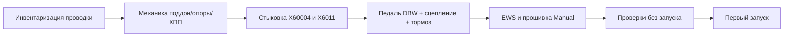

# План: M54B30 (BMW X5 E53, АКПП-донор) → BMW E46 (бывш. M43B19, МКПП)

Дата: 2026-10-20. Контекст: [BMW_E46_M43_to_M54_MS43_handoff.md](BMW_E46_M43_to_M54_MS43_handoff.md). Локальные источники: [research/sources/README.md](../research/sources/README.md).

**Для новичка (с нуля):** [M54_wiring_for_beginners.md](M54_wiring_for_beginners.md) · [Canvas](C:\Users\mihmi\.cursor\projects\e-CursorProject-e46-engine-swap\canvases\m54-x5-e46-swap-guide.canvas.tsx) (шаги + словарь).

**Визуальная версия:** [PDF](M54_swap_visual_guide.pdf) · [HTML](M54_swap_visual_guide.html).

## 0. Ваша конфигурация (зафиксировать до закупок)

| Параметр | Сейчас | Цель |
|----------|--------|------|
| Кузов | E46 318, **BMS46**, кабельный газ M43 | Сохранить кузовную проводку |
| Донор | **M54B30 E53**, моторная коса X5, **MS43**, двигатель с **АКПП** | Использовать **только** мотор + MS43 + моторную косу X5 |
| КПП | **МКПП E46** (остаётся) | МКПП + сцепление под M54 |
| DME | MS43 (5WK90019) | Прошивка под **M54 + МКПП** (не оставлять калибровку АКПП) |

**Критично:** редуктор/КПП от **M43 318** часто **не совместим** с M54 по длине/фланцу/колоколу. До монтажа подтвердите: какая именно МКПП стоит (Getrag 220 / 5HP и т.д.), совместим ли колокол с M54, длина кардана, вилка КПП. Если колокол не подходит — нужна **МКПП от 6-цил. E46/E39** (или проверенный комплект flywheel/clutch/bellhousing).

Если старая МКПП 318i остаётся, на машине уже проверено другое: передняя часть кардана от подвесного подшипника до коробки и скоба коробки берутся с E46 M54B22 или M54B25 на механике. Коробка садится примерно на 2 см назад. С M54B30 не проверено. См. [шаг 6 инструкции](swap-guide/e46-318i-m43b19-to-m54b30-x5.md).

---

## Фаза 1 — Разборка и инвентаризация (1–2 дня)

1. **Сфотографировать и подписать** все разъёмы на:
   - кузовной жгут E46 (40-pin у блока, X6011 в коробке у стенки моторного отсека, разъём у крыла из отчёта PL);
   - моторной косе X5 (X60001…X60005 на MS43, межжгутовые чёрные/синие разъёмы).
2. **Прозвонить** при снятых DME/EWS ключевые цепи кузова: лампа зарядки, давление/уровень масла, стартер, D+ генератора (см. [S_wds_E46_PA6000D_pinouts.md](../research/sources/pages/S_wds_E46_PA6000D_pinouts.md) X60004 для BMS46).
3. **Составить таблицу «есть / нет»** по MS43: педаль DBW, датчик сцепления, 4-проводной датчик педали тормоза, CAN АКПП на X60002, вторичный воздух, DMTL, тип вентилятора (PWM на X60004/4 у MS43).
4. **EWS:** записать номера DME, EWS, ключей; **не включать зажигание** с «чужим» комплектом без плана синхронизации ([MS4x Flasher](../research/sources/pages/S33_ms4x_flasher.wiki)).

---

## Фаза 2 — Механика (двигатель, навесное, КПП)

### 2.1 Подготовка M54 с X5

- Снять **всё лишнее от АКПП**: гидротрансформатор, кронштейны, датчики АКПП, лишние линии охлаждения АКПП на двигателе (если не используются).
- **Поддон и маслосборник:** для E46 почти всегда нужен **поддон/забор масла от E46/E39 M54** (или E53 с проверкой клиренса рулевой рейки). X5 поддон часто не подходит по геометрии. На машине поддон и щуп взяты от мотора M54, не от M43: [шаг 7](swap-guide/e46-318i-m43b19-to-m54b30-x5.md).
- **Помпа, термостат, натяжители, кронштейны** — сверить с E46 (компрессор A/C, крепления, шланги).
- **Прокладки:** полный набор при смене поддона и навесного.

### 2.2 Опоры двигателя

- Kрепления **E53 ≠ E46** — использовать **опоры E46 6-цил.** (или комплект под M54 в E46). Планировать до установки двигателя на подрамник. На машине так и сделано: лапы M54 от E46, [шаг 7](swap-guide/e46-318i-m43b19-to-m54b30-x5.md).

### 2.3 МКПП, сцепление, маховик

- **Маховик:** на этой машине оставлен маховик M43B19 вместе со старым сцеплением, [шаг 7](swap-guide/e46-318i-m43b19-to-m54b30-x5.md). Маховик с АКПП донора X5 под это сцепление не ставить.
- **Сцепление:** на этой машине оставлен комплект M43B19.
- **Выжимной:** E46, проверить ход вилки после смены маховика.
- **Датчик сцепления:** для MS43 на **X60004 pin 23** ([MS43 pinout](../research/sources/pages/S01_ms4x_ms43_pinout.wiki)); на M43 часто **не был проведён** — добавить модуль на главный цилиндр (**35426876898**, 4 провода: DME + EWS — см. [S_forum_fetch_gaps.md](../research/sources/pages/S_forum_fetch_gaps.md)).
- **Кардан / центральный подшипник:** после любой смены КПП/фланца — измерить.

### 2.4 Выхлоп, впуск, охлаждение

- **Коллекторы / даунпайп:** E46 6-цил. или адаптация под X5; кислородные датчики — по косе MS43.
- **Радиатор, вентилятор, патрубки:** E46 M54 часто требует **электровентилятор с PWM** (MS43 X60004/4) — проверить, что на кузове E46 318 есть соответствующая проводка или перенести с донора.
- **Обязательно:** новые **распорки подрамника**, осмотр **трещин задних опор** E46.

---

## Фаза 3 — Электрика: стратегия

**Принцип:** сохранить **моторную косу X5 + MS43** для датчиков/форсунок/катушек; **кузов E46** стыковать через **X60004 (40 pin)** и **межжгутовые** (X6011 и др.), а не перепиновывать всё «наугад».

Опорные документы:

| Что | Файл |
|-----|------|
| BMS46 X60004 (заводской тип PA6000D) | [S_wds_E46_PA6000D_pinouts.md](../research/sources/pages/S_wds_E46_PA6000D_pinouts.md) |
| MS43 все разъёмы | [S01_ms4x_ms43_pinout.wiki](../research/sources/pages/S01_ms4x_ms43_pinout.wiki) |
| Практика M43→M54 (PL) | [S04_e46forum_pl_m43_m54.md](../research/sources/pages/S04_e46forum_pl_m43_m54.md) |
| Педаль, X6011 (эталон MS42→MS43) | [S02_ms4x_m52tu_to_ms43.wiki](../research/sources/pages/S02_ms4x_m52tu_to_ms43.wiki) |

### 3.1 Питание DME (X60001, реле, предохранители)

- Сверить **X60001** X5 vs требования MS43 (30, 87, 15, массы) с кузовным питанием E46.
- На косе X5 от **АКПП** могут идти лишние цепи на X60002 (CAN EGS) — для **МКПП** линии **CAN gearbox** (X60002 pin 3–4) **не подключать к TCU**; оставить согласно схеме для manual (часто не используются — **не замыкать наугад**, сверить с WDS MS43 manual application).

### 3.2 X60004 — главный кузовной интерфейс

**BMS46 (ваш кузов)** — функции на pins 1, 2, 11, 21 (лампа, старт feedback, давление, уровень масла) — см. PA6000D.

**MS43** — те же *функции* на кузове **не на тех же пинах**; часть уходит на **X6011** на моторной стороне (подтверждено практикой M43→M54):

| Функция | BMS46 X60004 (PA6000D) | Действие на MS43 / X5 |
|---------|------------------------|------------------------|
| Лампа зарядки | 1 | На X6011 (у автора PL → pin 4) — **прозвонить на вашей косе X5** |
| Start feedback | 2 | X6011 pin 6 (PL) |
| Давление масла | 11 | X6011 pin 3 |
| Уровень масла | 21 | X6011 pin 5 |
| Стартер / D+ | другой разъём M43 | На X6011 pins 1–2 (PL) |

**Электронная педаль газа (обязательно):**

- Заменить тросовую педаль M43 на **DBW M54 manual** (MS4X PN: пластина 35 42 6 772 703 LHD, педаль **35 42 6 786 282** manual — [S02](../research/sources/pages/S02_ms4x_m52tu_to_ms43.wiki)).
- Проводка X11400 → X60004: pins 1→7, 2→12, 3→14, 4→8, 5→9, 6→13.

**Добавить с кузова / периферии (типично для MS43 + МКПП):**

| X60004 MS43 | Назначение |
|------------:|------------|
| 23 | Датчик сцепления |
| 24, 28 | Педаль тормоза (BLS) — **4-проводный** датчик для cruise/MS43 |
| 27 | MFL/cruise (если есть tempomat) |
| 10 | Сигнал **реле** бензонасоса (не силовой «+» насоса) |

**Pin 3 MS43 (SAP):** не удалять автоматически; если SAP нет — оставить неподключённым или заглушить по схеме.

### 3.3 X6011 на косе X5

Номера на **E53** могут не совпадать с подписью «X6011» в инструкции E46 — **найти 8-pin чёрный** мост engine/body на X5 и прозвонить 6 сигналов к X60004 MS43. Записать в таблицу «факт X5» перед финальной обжимкой.

### 3.4 Разъём у крыла (3 vs 4 провода)

По отчёту PL: подружить 3 провода M54 с оставшимся M43, **4-й убрать** (фонарь заднего хода — проверить по вашей комплектации).

### 3.5 EWS / ключ / стартер

Варианты (выбрать один до первого включения):

1. **Перенос EWS + вставка замка + ключ** с донора X5 (как в PL) — максимально «родной» комплект.
2. **Синхронизация** имеющегося E46 EWS с MS43 (INPA / MS4x tools) — только с пониманием процедуры.
3. **Delete EWS** в прошивке MS43 — отдельное решение по законности и надёжности.

Стартер и **terminal 50** — через X6011/кузовные цепи; «start feedback» ≠ силовая линия стартера.

### 3.6 АКПП-донор → прошивка MS43

- Уточнить, что DME **не прошит только под E53 automatic** (характеристики трансмиссии, idle, limp CAN EGS).
- План: прошивка **Manual / E46 330** base или калибровка через **TunerPro / MS4x** ([S34 patchlist](../research/sources/pages/S34_ms4x_patchlist.wiki)).
- После прошивки — **адаптации** DME (педаль, VANOS, O2, при необходимости EWS sync).

---

## Фаза 4 — Сборка и проверки без запуска

1. Все **массы** двигателя и кузова (в т.ч. X6454/X6458 по MS43).
2. **Педаль DBW** — без 12 V на сигнальных пинах; только штатные 5 V от DME.
3. **Топливо:** реле EKP по X60004/10, **не** подавать постоянный +12 на насос «для проверки» вместо логики DME.
4. **CAN** кузова (X60004 36–37) — сохранить пару, не перепутать с CAN АКПП на X60002.
5. **OBD** — K-line/CAN на X60001/X60004 по MS43.

---

## Фаза 5 — Первый запуск и обкатка

1. Масло, ОЖ, **прокачка сцепления**, проверка утечек.
2. **INPA / PA soft:** ошибки DME, EWS, педали, idle.
3. **Проверить:** лампа зарядки, давление/уровень масла на приборке, вентилятор (PWM), A/C clutch (pin 29 BMS46 / аналог MS43).
4. **Короткий первый пуск**, затем прогрев, затем тест-драйв без нагрузки.

---

## Фаза 6 — Доработки после первых поездок

- Cruise / MFL (pin 27), если нужен tempomat.
- Точная подстройка **датчика сцепления** (обороты при выжиме).
- Cyprus / EU: **регистрация** смены двигателя, emissions — отдельный чеклист ([swap-work-areas.md](swap-work-areas.md) §7).

---

## Порядок работ (краткий Gantt)

---

## Открытые задачи исследования (до «закрытия» схемы)

1. Заполнить **40×40** BMS46 vs MS43 с источником на каждый pin ([handoff §10](BMW_E46_M43_to_M54_MS43_handoff.md)).
2. **Протрассировать X6011 на косе X5** (не копировать номера E46).
3. Подтвердить **модель МКПП** и комплект **flywheel/clutch**.
4. Скачать вручную вложения **S27** / форумы из [S_forum_fetch_gaps.md](../research/sources/pages/S_forum_fetch_gaps.md).
5. Проверить **MS43 Index 08** на соответствие M54B30 **manual** (не E53 auto).

---

## Уверенность

| Блок | Уверенность |
|------|-------------|
| Перенос 4 индикаторных цепей + X6011 | Средняя — проверено на практике PL, не на вашем VIN |
| BMS46 X60004 PA6000D | Высокая для **назначений BMS46** |
| MS43 pinout | Высокая (MS4X) |
| Стыковка **X5** межжгутов | Низкая до прозвонки |
| МКПП M43 + M54 | **Требует подтверждения** — частый стоп-фактор |
