# Что стоит на кузове E46 и на косах

Справка, с чем шла работа до того, как свап завелся. Здесь только то, что видно на фотографиях: какая деталь на каком кадре и как она называется. Как это соединять — в [инструкции](swap-guide/e46-318i-m43b19-to-m54b30-x5.md).

Кузов: BMW E46, до свапа мотор M43B19 (BMS46), механическая коробка остаётся. Донор: M54B30 от X5 E53 с автоматической коробкой, моторная коса X5 и MS43.

Фото лежат в [`docs/wiring-photos/`](wiring-photos/). Оригиналы съёмки:

| Папка | Что снимали |
|-------|-------------|
| [`photos/кузов 46/`](../photos/кузов%2046/) | Кузовная стойка E-box E46 и снятая моторная коса M43 |
| [`photos/моторная коса м54б30 с х5/`](../photos/моторная%20коса%20м54б30%20с%20х5/) | Моторная коса M54 / X5. Один кадр из этой папки — кузовная стойка, не коса |

`harness-01` снят из папки косы X5, но на кадре кузовная стойка E46. `body-03` и `body-04` лежат в папке «кузов», но это снятая моторная коса M43, не кузовной жгут.

## Что на каком фото

| Файл | Где снимали | Что на кадре |
|------|-------------|--------------|
| `body-08`, `body-09`, `body-10` | кузов 46 | Кузовная стойка E-box: 4-pin со штырями, силовой разъём с толстым красным, чёрный 2-pin, салатовое реле |
| `harness-01` | папка косы X5 | Та же кузовная стойка, снятая вертикально |
| `body-03` | кузов 46 | Снятая моторная коса M43: жёлтый носитель, блок MOTOR-SICHERUNGEN, синее и зелёное реле, гофра |
| `body-04` | кузов 46 | Вилки снятой косы M43, которые стыковались со стойкой: 4 гнезда, сдвоенная с толстыми красными, 8-местная чёрная, серая с рычагом |
| `harness-02` | коса X5 | Носитель косы X5: MOTOR-SICHERUNGEN, реле, чёрный 2-местный силовой разъём, белый AMP, чёрный сигнальный разъём, малый белый |
| `harness-05`…`07` | коса X5 | Белый AMP, маркировка `AMP 2-828879-1` / `BMW 1 378 137`: корпус, тыл с проводами, сторона штырей |

На стойке слева направо (`body-09`): 4-pin, силовой разъём с одним толстым красным, чёрный 2-pin. Слева от них салатовое реле.

По заводским обозначениям, которыми эти корпуса подписаны в WDS для E46 с M43: левый 4-pin — X6021 (Engine plug II), правый чёрный 2-pin — X6011 кузова (Engine plug I, на этой машине 2-pin). Центральный разъём — силовой, с одним толстым красным. Белый 12-местный корпус на косе X5 — X6011 от E53. MOTOR-SICHERUNGEN стоит на моторных косах, не на кузовной стойке: на X5 это `harness-02`, на снятой косе M43 — `body-03`.

## Кузовная стойка E46

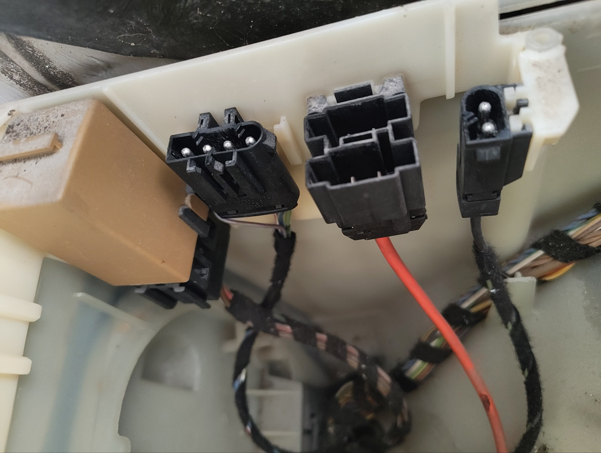

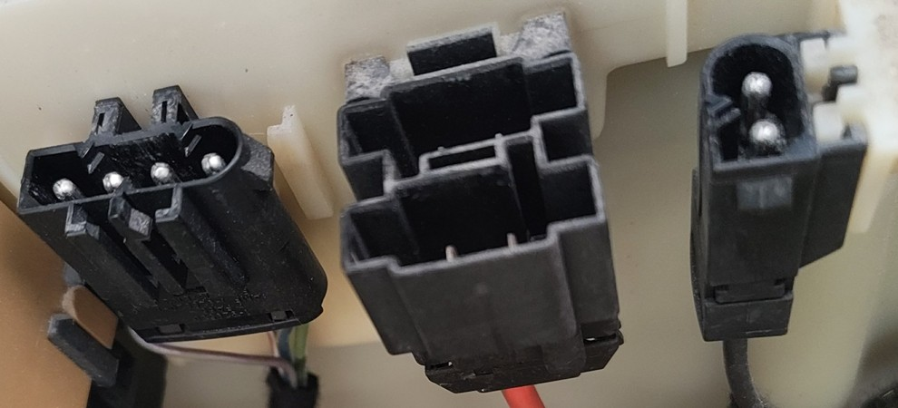

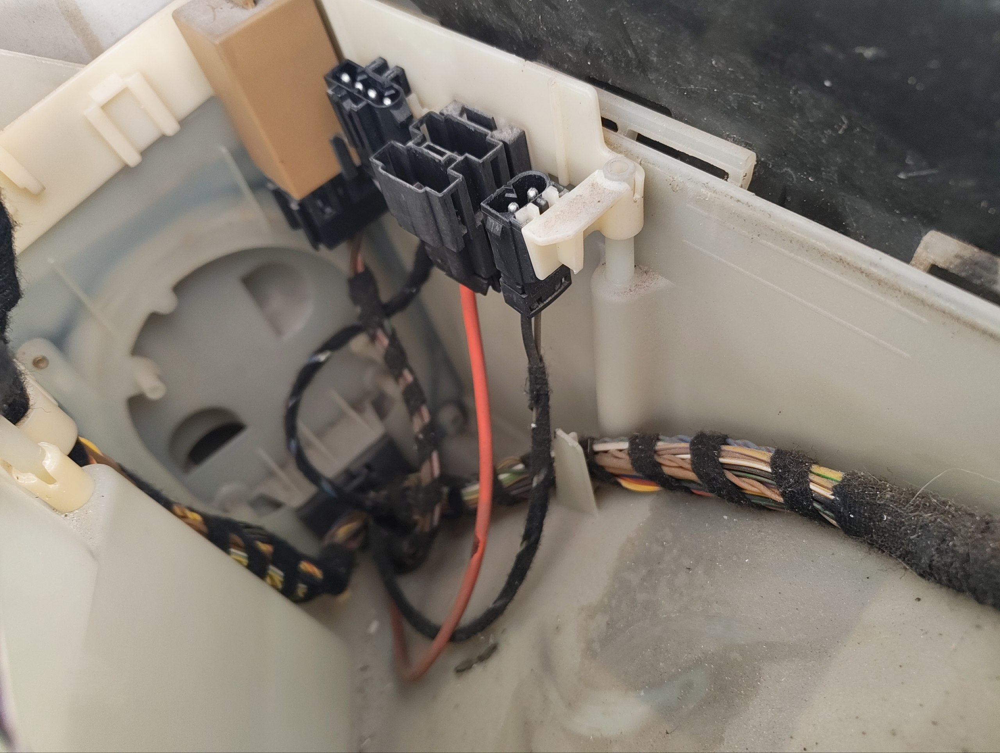

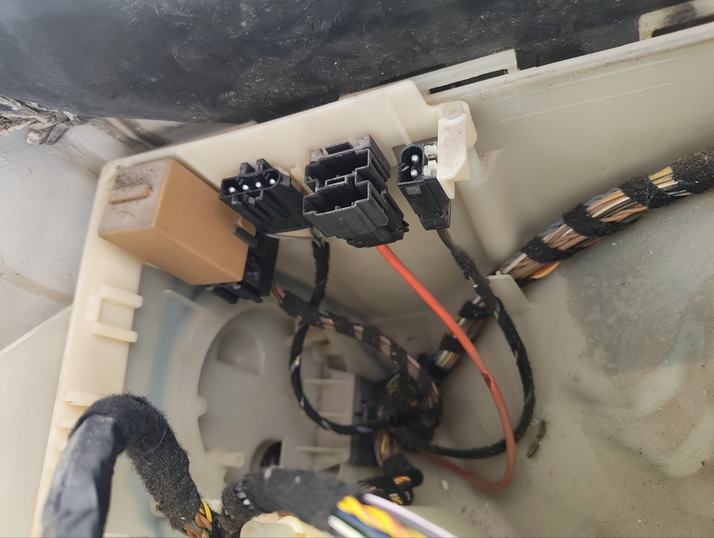

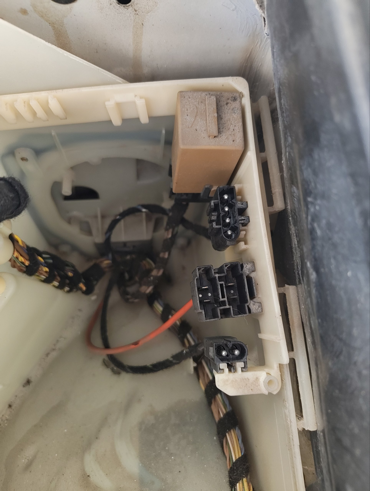

## Снятая моторная коса M43

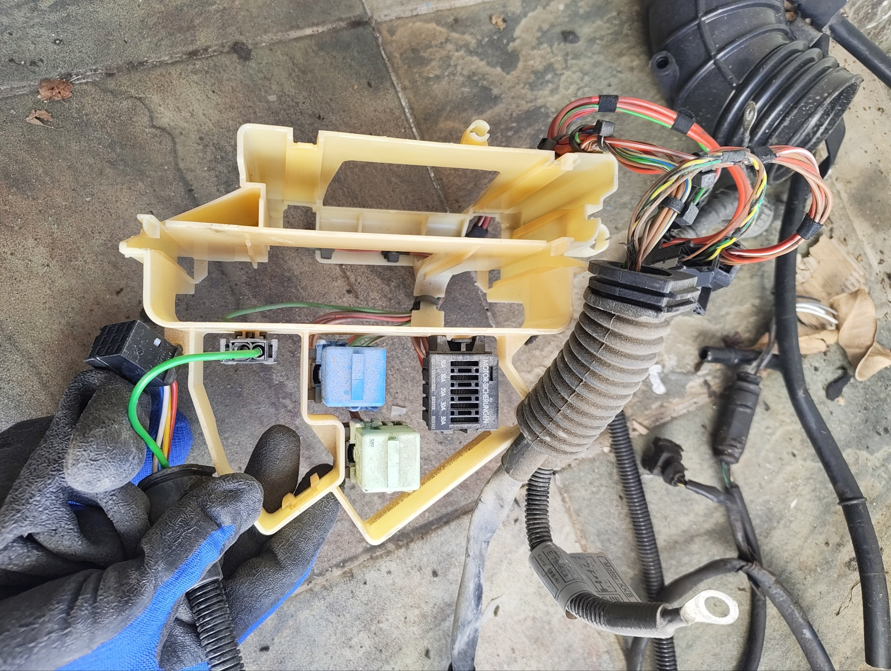

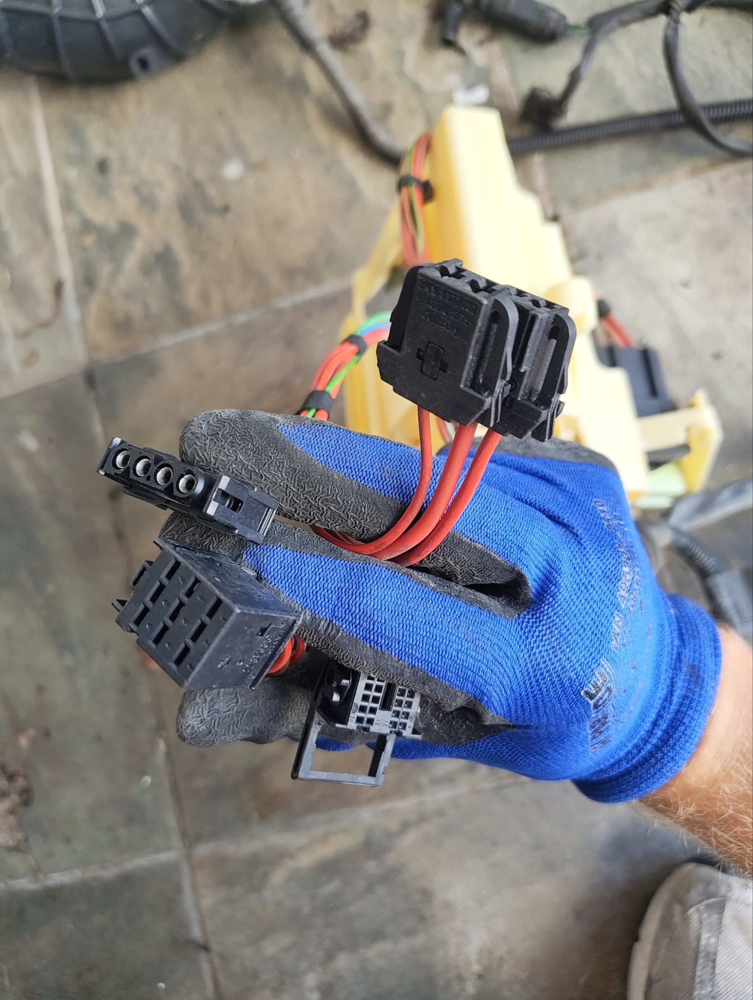

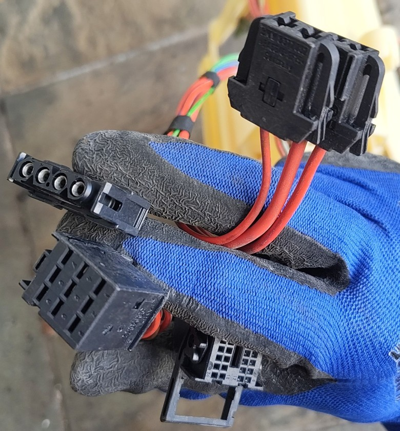

## Моторная коса M54 с X5

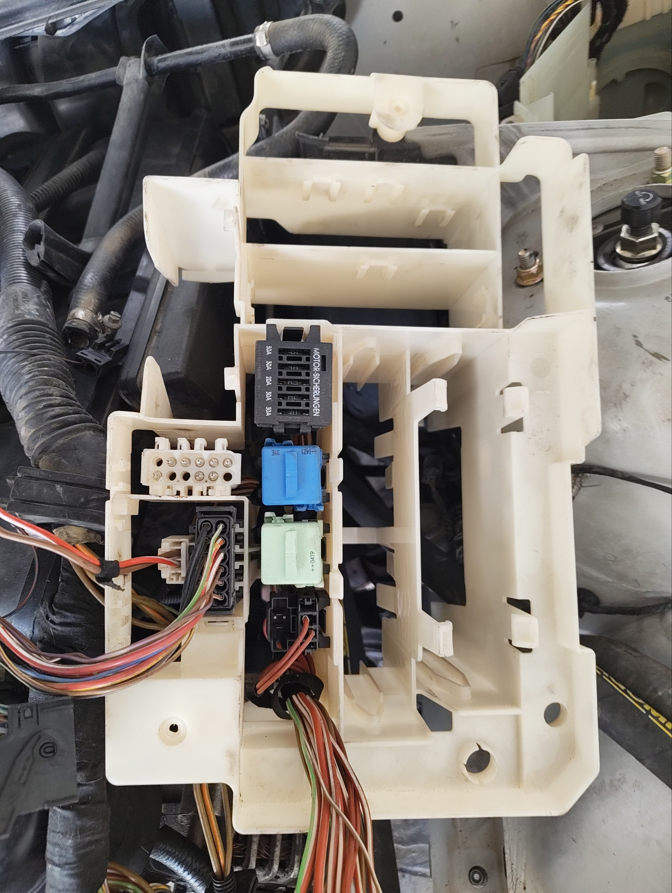

Под зелёным реле — чёрный 2-местный силовой разъём. В левом гнезде штыри без провода. В соседнем гнезде два толстых красных уходят в косу, к блоку MOTOR-SICHERUNGEN.

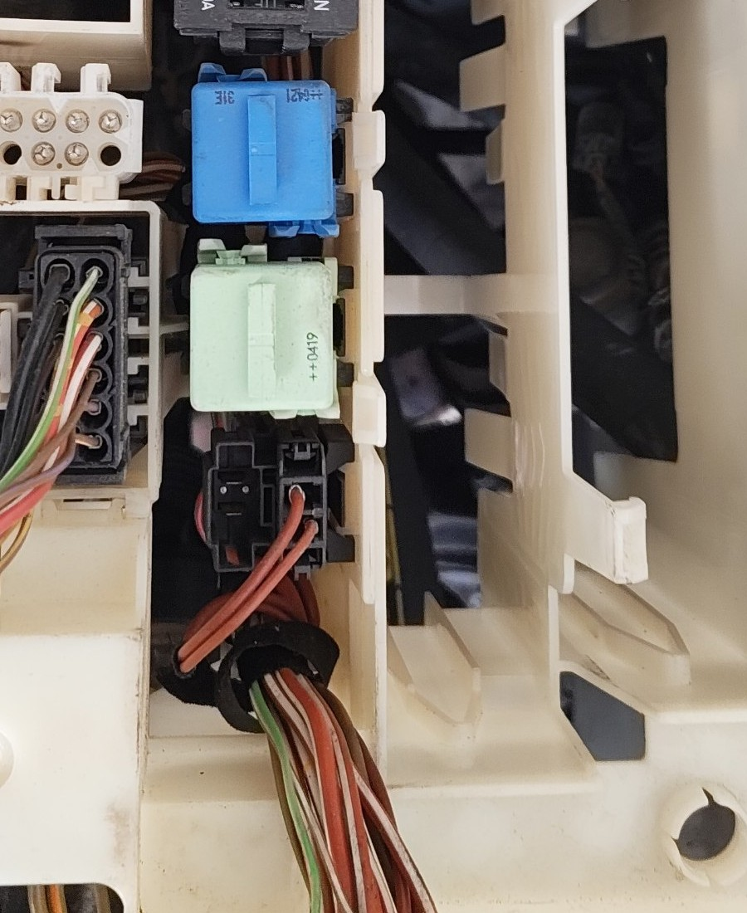

Рядом на том же носителе белый AMP, чёрный многоконтактный разъём и малый белый.

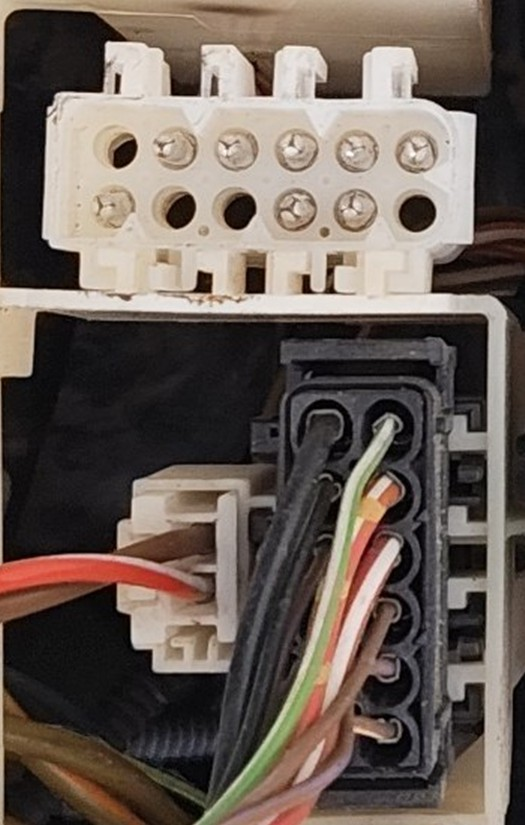

На белом корпусе маркировка `AMP 2-828879-1` / `BMW 1 378 137`. Мест на корпусе 12, проводами занято 8.

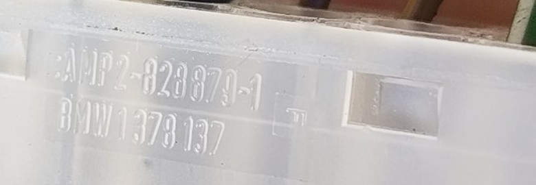

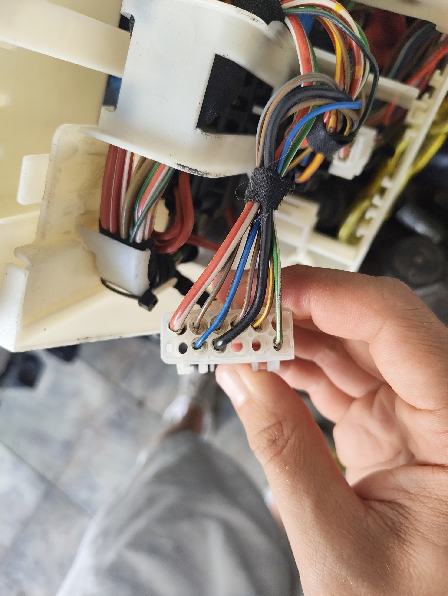

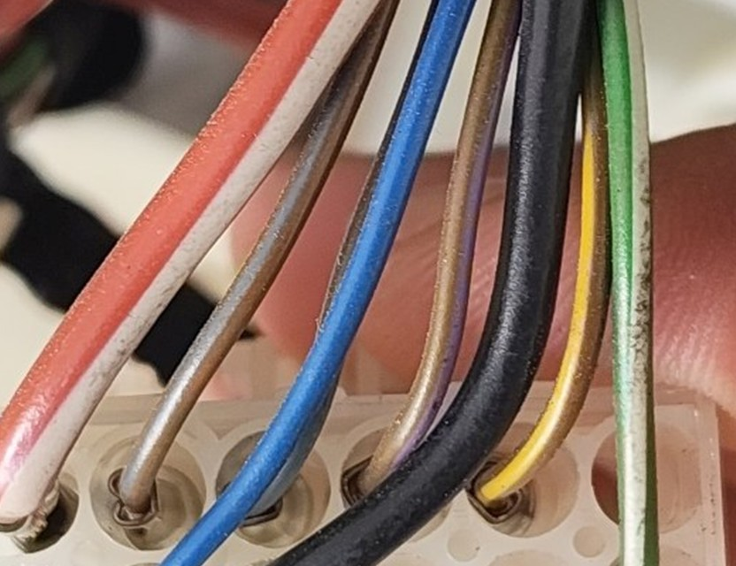

На этом тыле видны: толстый красный с белой полосой, коричнево-серый, синий, коричневый с фиолетовой полосой, толстый чёрный, жёлто-коричневый, зелёный с белой полосой. Восьмой провод на кадре не читается. Номера гнёзд — по маркировке на корпусе.

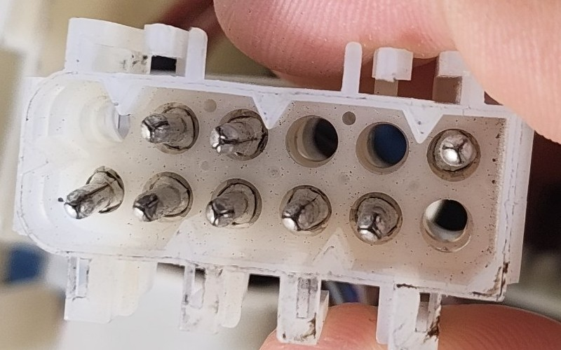

## Источники, которыми пользовались при разборе

Заводские листы и зеркала, на которые опирались имена разъёмов на этих фото:

- WDS E46, лист PA6000D (BMS46, X60004): [локальная копия](../research/sources/pages/S_wds_E46_PA6000D_pinouts.md)
- WDS E46, лист PA6000J (MS43, X60004): [локальная копия](../research/sources/pages/S_wds_E46_PA6000J_pinouts.md)
- WDS E46, X6011 / X6021: `research/sources/files/S_wds_E46_EX6011A.htm` … `EX6011F.htm`, `S_wds_E46_EX6021A.htm`, `EX6021B.htm`
- WDS E46, X6053 / X6054: [S_wds_E46_EX6053D.htm](../research/sources/files/S_wds_E46_EX6053D.htm)
- WDS E53, оглавление: http://iho-bmw.s3-website-us-west-2.amazonaws.com/e53/
- WDS E39, X6011 12-pin natural и X6053 12-pin black: http://iho-bmw.s3-website-us-west-2.amazonaws.com/zinfo/E39_EX6011E.htm
- WDS E39, распиновки X6011: http://iho-bmw.s3-website-us-west-2.amazonaws.com/zinfo/E39_PX6011C.htm и http://iho-bmw.s3-website-us-west-2.amazonaws.com/zinfo/E39_PX6011D.htm
- MS4X, HowTo M52TU → MS43 (2-pin и 8-pin X6011, педаль): https://www.ms4x.net/index.php?title=HowTo:_Convert_M52TU_Engine_to_MS43 — [локальная копия](../research/sources/pages/S02_ms4x_m52tu_to_ms43.wiki)
- MS4X, распиновка MS43: https://www.ms4x.net/index.php?title=Siemens_MS43_Pinout — [локальная копия](../research/sources/pages/S01_ms4x_ms43_pinout.wiki)
- Польский отчёт M43 → M54: https://e46forum.pl/bmw-e46-swap-m43-na-m54-18149-5 — [выписка](../research/sources/pages/S04_e46forum_pl_m43_m54.md)
- Tulay, адаптер сигналов приборки MS42 → MS43 и цвета проводов X60004: [S39_tulay_ms42_ms43_adapter.html](../research/sources/files/S39_tulay_ms42_ms43_adapter.html)
- Tulay, белый 12-pin E53 M54 Engine Plug I, X6011: https://tulayswirewerks.com/product/bmw-12-pin-white-unsealed-plug-e53-m54-engine-plug-i-x6011-chassis-harness-connector-kit/
- Корпус BMW `61 13 1 378 137` / AMP `2-828879-1`: https://www.bimmerforums.com/forum/showthread.php?2126758-DIY-Interfacing-with-the-12-pin-harness-connector
